  

  
  
  
  

---

## About

I'm **Fazo Khan** (`Fazokhan`), an Android systems engineer and open source developer. My work sits close to the metal: patching Dalvik bytecode (smali) in system APKs, compiling and optimizing on-device with `dex2oat`, tuning `build.prop` for smoothness, and debugging init and boot behavior when something goes wrong at startup.

I lead development and maintenance on my projects, and I believe good software is built in the open. Clear code, honest documentation, and a stable release matter more to me than a flashy feature list.

## What I work on

- **System modification:** SystemUI, status bar, and settings internals on Android
- **Boot and init debugging:** tracing failures through `init` and fixing ports that bootloop
- **Performance tuning:** `build.prop` and runtime tuning for scrolling and responsiveness
- **Developer tooling:** scripts and bots that make releases and support repeatable

## Open source philosophy

  
  
  
  

I share what I build, document how it works, and credit the people who help. Open source is a conversation, and I try to keep mine kind and useful.

## Tech stack

  
  
  
  
  
  
  

## Connect

  
  

---

  Built in the open. Let's spread love ❤️

